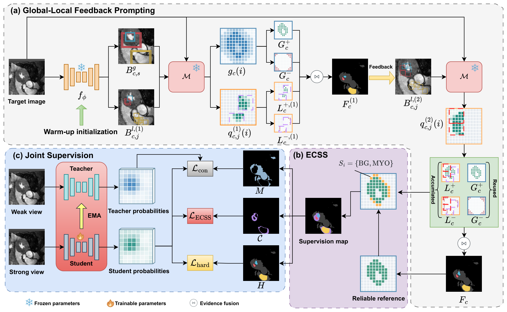

# ASEI

**ASEI: Learning from Global and Local SAM Evidence for Source-Free Domain Adaptation in Cross-Modality Cardiac Segmentation**

**ASEI (Adaptation via SAM Evidence Integration)** uses global and local evidence from MedSAM for source-free domain adaptation in cross-modality cardiac segmentation through feedback prompting and set supervision. It supports **CT→MR** and **MR→CT** adaptation.



Install the dependencies from the repository root:

```bash
pip install -r requirements.txt
```

Download the ViT-B checkpoint from the [official MedSAM repository](https://github.com/bowang-lab/MedSAM#get-started) and place it at `checkpoints/medsam_vit_b.pth`.

## 1. Data Preparation

Download the [preprocessed data provided by SIFA](https://github.com/cchen-cc/SIFA#data-preparation), arrange it under `data/raw/MMWHS/` following the [data preparation guide](docs/DATA.md), and run:

```bash
python scripts/prepare_data.py \
  --raw-root data/raw/MMWHS \
  --output-root data/mmwhs
```

If the data is already prepared, set `data.root` in the configuration file directly.

## 2. Source Training

```bash
# CT source model
python scripts/train_source.py --config configs/source_ct.yaml

# MR source model
python scripts/train_source.py --config configs/source_mr.yaml
```

Source samples are split into training and validation sets at a ratio of 8:2. The best checkpoint is selected by validation Dice.

## 3. Target Adaptation

```bash
# CT → MR
python scripts/adapt_target.py --config configs/ct_to_mr.yaml

# MR → CT
python scripts/adapt_target.py --config configs/mr_to_ct.yaml
```

The pipeline performs Mean Teacher pre-adaptation, GLFP pseudo-label generation, ECSS class-set construction, and joint supervision training in sequence. Both directions use 1500 pre-adaptation steps at a learning rate of 1e-5, followed by 1000 adaptation steps at 1e-5 for CT→MR and 1e-4 for MR→CT. Configure data, checkpoint, and output paths in the corresponding YAML file.

## 4. Evaluation

```bash
# CT → MR
python scripts/evaluate.py --config configs/ct_to_mr.yaml

# MR → CT
python scripts/evaluate.py --config configs/mr_to_ct.yaml
```

By default, evaluation uses the final teacher checkpoint `teacher_final.pt` and reports 3D Dice and ASSD. Results are saved to `evaluation.json` in the corresponding run directory.

## Acknowledgments

We thank the following projects for their code, pretrained models, and data preprocessing resources:

- [SIFA](https://github.com/cchen-cc/SIFA)
- [SAM](https://github.com/facebookresearch/segment-anything)
- [MedSAM](https://github.com/bowang-lab/MedSAM)

The original licenses for third-party components are retained in `third_party/`.
